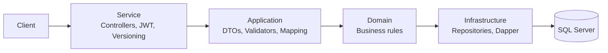

# Ecommerce API

A layered backend API built with **ASP.NET Core (.NET 10)**: JWT authentication, API versioning, request validation, Dapper data access, structured logging and health checks, with interactive documentation served by **Scalar**.

> Practice project based on an enterprise backend architecture course. It is used to apply and extend those concepts on a real, runnable codebase.

## Features

- **JWT authentication**: sign up and sign in, passwords hashed with ASP.NET Core `IPasswordHasher`.
- **API versioning** by URL segment (`/api/v1/...` is deprecated, `/api/v2/...` is current). v2 adds paginated listing.
- **Customers CRUD** over a SQL Server database (Northwind schema).
- **Validation** with FluentValidation, returning a consistent response envelope.
- **Dapper + Unit of Work** data access using stored procedures.
- **Serilog** logging to console, rolling files and SQL Server (warnings and above).
- **Health checks** with a dashboard UI (`/health`, SQL Server probe and a custom check).
- **OpenAPI documentation** generated per API version and rendered with Scalar, with a Bearer token field to try protected endpoints.
- **Integration tests** (MSTest + `WebApplicationFactory`).
- **Dockerfile** (multi-stage build).

## Architecture

Request flow through the layers:



| Layer          | Projects                                                | Responsibility                                                      |
| -------------- | ------------------------------------------------------- | ------------------------------------------------------------------- |
| Service        | `Services.WebApi`                                       | HTTP endpoints, authentication, versioning, API docs, health checks |
| Application    | `Application.DTO`, `.Interfaces`, `.Main`, `.Validator` | Use cases, input validation, entity/DTO mapping (AutoMapper)        |
| Domain         | `Domain.Entity`, `.Interfaces`, `.Core`                 | Entities and business rules                                         |
| Infrastructure | `Infrastructure.Data`, `.Interfaces`, `.Repository`     | Dapper context, repositories, Unit of Work                          |
| Transversal    | `Transversal.Common`, `.Logging`                        | Response types, JWT service, logging                                |
| Tests          | `Application.IntegrationTest`                           | Integration tests                                                   |

## Tech stack

.NET 10 · ASP.NET Core · Dapper · SQL Server · AutoMapper · FluentValidation · Asp.Versioning · JWT Bearer · Serilog · Swashbuckle (OpenAPI generation) · Scalar · MSTest · Docker

## API overview

Authentication is required on every endpoint except `signup` and `signin`.

| Method | Route                                               | Description                | Versions |
| ------ | --------------------------------------------------- | -------------------------- | -------- |
| POST   | `/api/v{version}/Auth/signup`                       | Register a user            | v1, v2   |
| POST   | `/api/v{version}/Auth/signin`                       | Authenticate and get a JWT | v1, v2   |
| POST   | `/api/v{version}/Customers/insert`                  | Create a customer          | v1, v2   |
| PUT    | `/api/v{version}/Customers/update/{customerId}`     | Update a customer          | v1, v2   |
| DELETE | `/api/v{version}/Customers/delete/{customerId}`     | Delete a customer          | v1, v2   |
| GET    | `/api/v{version}/Customers/getbyid/{customerId}`    | Get a customer by id       | v1, v2   |
| GET    | `/api/v{version}/Customers/list`                    | List all customers         | v1, v2   |
| GET    | `/api/v2/Customers/list-pag/{pageNumber}?pageSize=` | Paginated list             | v2       |

The full, interactive reference is available at `/scalar` when running in Development.

## Getting started

### Prerequisites

- [.NET 10 SDK](https://dotnet.microsoft.com/download)
- SQL Server (local install or Docker)
- Git

### 1. Database

The API uses the **Northwind** sample database (`Customers` table) plus a `Users` table, and talks to the database through stored procedures:

- Customers: `CustomersInsert`, `CustomersUpdate`, `CustomersDelete`, `CustomersGetById`, `CustomersList`, `CustomersListWithPagination`
- Users: `UsersInsert`, `UsersGetByEmail`

> **Note:** the SQL scripts for the `Users` table and the stored procedures are not in this repository yet. Add them under `database/` and list them here.

A local SQL Server with Docker:

```bash
docker run -e "ACCEPT_EULA=Y" -e "MSSQL_SA_PASSWORD=<strong-password>" \
  -p 1433:1433 -d mcr.microsoft.com/mssql/server:2022-latest
```

### 2. Configuration

Secrets are **not** stored in the repository. `appsettings.json` contains placeholders, and real values are provided with .NET user secrets (local development) or environment variables (everywhere else).

```bash
P=Servicio/Pacogroup.Ecommerce.Servicio.WebApi
dotnet user-secrets init --project $P
dotnet user-secrets set "Jwt:Key" "$(openssl rand -base64 64 | tr -d '\n')" --project $P
dotnet user-secrets set "ConnectionStrings:NorthwindConnection" \
  "Server=localhost,1433;Database=Northwind;User Id=<user>;Password=<password>;TrustServerCertificate=True" --project $P
```

| Setting                                 | Environment variable                              |
| --------------------------------------- | ------------------------------------------------- |
| `Jwt:Key`                               | `Jwt__Key`                                        |
| `ConnectionStrings:NorthwindConnection` | `ConnectionStrings__NorthwindConnection`          |
| `Cors:OriginCors`                       | `Cors__OriginCors__0`, `Cors__OriginCors__1`, ... |

### 3. Run

```bash
dotnet run --project Servicio/Pacogroup.Ecommerce.Servicio.WebApi
```

- API reference (Scalar): `https://localhost:7146/scalar` (the root `/` redirects there in Development)
- Health check: `/health`

To try a protected endpoint: call `signup`, then `signin`, copy the token and paste it into the **Bearer** field in Scalar.

### Run with Docker

The build context must be the repository root:

```bash
docker build -f Servicio/Pacogroup.Ecommerce.Servicio.WebApi/Dockerfile -t ecommerce-api .
docker run -p 8080:8080 \
  -e ASPNETCORE_ENVIRONMENT=Development \
  -e Jwt__Key="<key>" \
  -e ConnectionStrings__NorthwindConnection="<connection-string>" \
  ecommerce-api
```

API docs are only exposed in the `Development` environment.

## Tests

The integration tests exercise the authentication flow against a real SQL Server, so the database and configuration above are required:

```bash
export ConnectionStrings__NorthwindConnection="<connection-string>"
export Jwt__Key="<key>"
dotnet test
```

## Project status

Work in progress. Planned next steps:

- [ ] SQL scripts for the schema and stored procedures
- [ ] Unit tests for the domain and application layers
- [ ] Rate limiting
- [ ] CQRS with a mediator
- [ ] Redis caching and messaging with RabbitMQ

## Author

**Lorenzo Lagos**: .NET backend developer. [GitHub](https://github.com/loranlagos)
